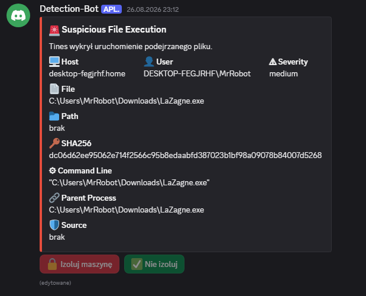
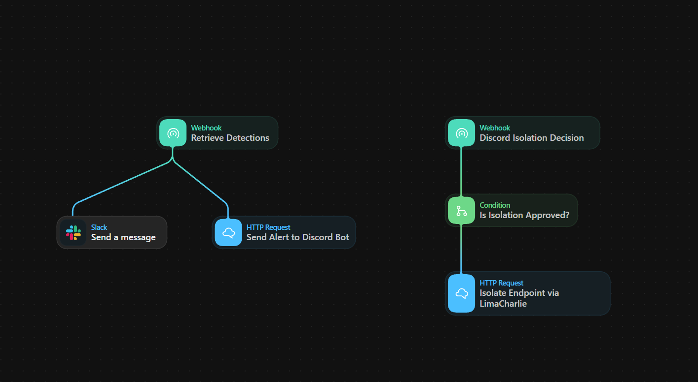

# HBT-SOAR-EDR

Human-in-the-loop detection and response lab integrating **LimaCharlie EDR**, **Tines SOAR** and a custom **Discord bot written in Python**.

The project detects suspicious activity on a Windows endpoint, sends the alert to Tines and Discord, and allows an analyst to approve endpoint isolation directly from Discord.

## Architecture

```text
Windows Endpoint
      ↓
LimaCharlie EDR
      ↓
Tines SOAR
      ↓
Discord Alert
      ↓
[ Isolate ] [ Do Not Isolate ]
      ↓
Tines
      ↓
LimaCharlie API
      ↓
Endpoint Isolation
```

## Workflow

1. LimaCharlie detects suspicious endpoint activity.
2. The detection is sent to Tines through a webhook.
3. Tines forwards the alert to the Discord bot.
4. The bot sends a structured DM containing:
   - hostname
   - username
   - severity
   - file path
   - SHA256
   - command line
   - parent process
5. The analyst chooses:
   - `🔒 Isolate Machine`
   - `✅ Do Not Isolate`
6. The decision is sent back to Tines.
7. If isolation is approved, Tines calls the LimaCharlie API and isolates the endpoint.



## Tines Workflow



The workflow contains two separate flows:

```text
Detection:
LimaCharlie → Tines → Discord / Slack

Response:
Discord → Tines → LimaCharlie API
```

## Detection Rules

Custom LimaCharlie D&R rules are included in the `limacharlie/` directory.

Current detections include:

| Detection | MITRE ATT&CK |
|---|---|
| Credential dumping tools | T1003 |
| LSASS dumping | T1003.001 |
| Encoded PowerShell | T1059.001 |
| PowerShell reverse shell | T1059.001 |
| Netcat reverse shell | T1059 |
| Certutil download/decode | T1105 |
| BITSAdmin download | T1197 |
| Regsvr32 proxy execution | T1218.010 |
| Scheduled Task creation | T1053.005 |
| Windows Service creation | T1543.003 |
| Windows Defender tampering | T1562.001 |
| Office application spawning shell | T1204.002 |
| LaZagne execution | T1003 |

Example response metadata:

```yaml
- action: report
  name: Suspicious PowerShell Execution
  priority: 4
  metadata:
    level: high
    technique: T1059.001
```

Severity and MITRE metadata are passed from LimaCharlie to Tines and then displayed in Discord.

## Discord Bot

The bot is written in Python using:

```text
discord.py
aiohttp
python-dotenv
```

It exposes:

```text
POST /tines-alert
```

Tines authenticates using:

```text
X-Tines-Secret
```

The bot validates the secret before accepting the alert.

Only the Discord user configured in:

```text
DISCORD_USER_ID
```

can approve endpoint isolation.

## Project Structure

```text
HBT-SOAR-EDR/
│
├── bot/
│   └── Discord_Bot.py
│
├── docs/
│   └── tines-workflow.png
│
├── limacharlie/
│   └── *.yaml
│
├── tines/
│   └── HBT-SOAR-EDR.json
│
├── .env.example
├── .gitignore
├── requirements.txt
└── README.md
```

## Configuration

Install dependencies:

```bash
pip install -r requirements.txt
```

Create `.env`:

```env
DISCORD_TOKEN=
DISCORD_USER_ID=
TINES_SECRET=
TINES_DECISION_WEBHOOK=
TINES_DECISION_SECRET=
PORT=8080
```

Start the bot:

```bash
python bot/Discord_Bot.py
```

The real `.env` file is excluded from Git.

## What I Learned

This project gave me practical experience with:

- creating custom EDR detection rules in LimaCharlie
- analyzing process, command-line and parent-process telemetry
- mapping detections to MITRE ATT&CK
- building SOAR workflows in Tines
- working with webhooks and REST APIs
- implementing human-approved endpoint isolation
- handling API authentication and JWTs
- securing secrets with environment variables and Tines Credentials
- building an asynchronous Discord bot in Python
- troubleshooting HTTP `400`, `401`, `404` and `500` errors across multiple systems
- tracing failures across a full detection-response pipeline

The biggest takeaway was learning how to connect **EDR detection, SOAR automation and analyst response** into one working workflow instead of treating each tool separately.

## Security

No API keys, Discord tokens or webhook secrets are stored in the repository.

Sensitive values are managed through:

```text
.env
Tines Credentials
Shared webhook secrets
```

The exported Tines Story included in the repository is sanitized.


## Disclaimer

This project was built and tested in a controlled lab environment for cybersecurity learning and authorized testing.
